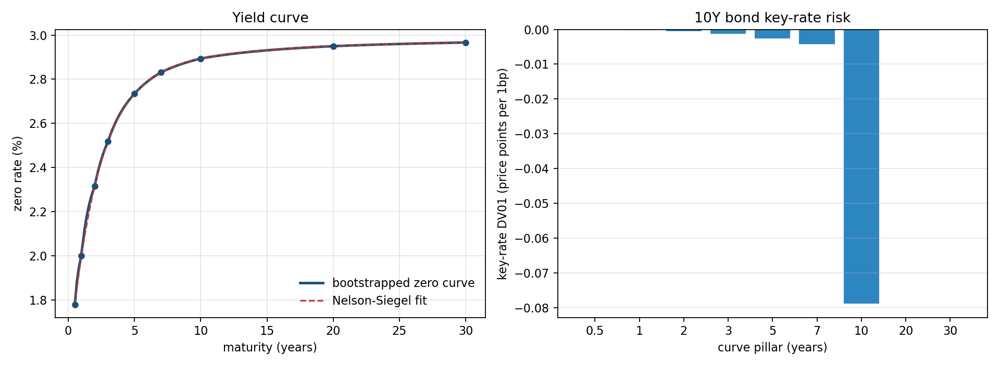

# Kairos Rates · 利率与固定收益研究库

[](https://github.com/Bruce848647703/kairos-rates/actions/workflows/ci.yml)

> **从报价到风险**：存款/互换 bootstrap → Nelson-Siegel / Svensson → Vasicek / CIR / Hull-White →
> 债券与利率互换定价 → 平行 DV01 与关键利率久期。

零第三方依赖（`numpy` + 标准库），42 个测试 + GitHub Actions CI，全程确定性可复现。

---

## 1. 为什么需要它

固定收益的第一性原理只有一条：**贴现因子**。所有零息利率、远期利率、平价互换利率、
债券价格、久期、DV01 都是 `df(t)` 的推论。所以这个库的结构很直接：

```
报价（存款/互换） → bootstrap → df(t) 曲线 → 一切定价与风险
                                   ↑
                      NS / Svensson 参数化拟合
                                   ↑
        Vasicek / CIR / Hull-White（用曲线校准短期利率模型）
```

难点不在公式，而在**口径**：存款用单利还是连续复利？互换的付息日怎么对齐？中间付息日
落在两个 pillar 之间时怎么插值？关键利率久期怎么加总回平行 DV01？这个库把这些问题
全部显式化，并用测试钉死。



（左：bootstrap 出的零息曲线与 Nelson-Siegel 拟合；右：10Y 债券的关键利率 DV01。）

## 2. 快速开始

```bash
git clone https://github.com/Bruce848647703/kairos-rates && cd kairos-rates
python -m pip install -e ".[dev]"

python -m kairos_rates                                   # 完整演示
python -m kairos_rates curve --csv curve.csv             # 从报价 bootstrap
python -m kairos_rates bond --coupon 0.03 --maturity 10
python -m kairos_rates swap --maturity 5 --notional 1000000
```

曲线 CSV 只有四列：`kind, maturity, rate, frequency`，`kind ∈ {deposit, swap, zero}`。

## 3. 模块

| 模块 | 内容 |
|---|---|
| `daycount` | ACT/360、ACT/365F、30/360、ACT/ACT；月末偏移与付息日生成 |
| `curve` | `DiscountCurve`（对数线性插值）、零息/远期/平价利率、平移与单点冲击 |
| `curve.bootstrap` | 顺序反解给初值 + **Newton 联立精修**，保证每条报价被精确重定价 |
| `models` | Nelson-Siegel / Svensson 拟合；Vasicek / CIR / Hull-White 解析债券价格与模拟 |
| `instruments` | 固定利率债券（价格/YTM/久期/凸性/应计）、利率互换（PV/平价/DV01） |
| `instruments` (风险) | 平行 DV01、关键利率久期（逐 pillar 冲击 + 捕获率） |
| `data` | 合成曲线/报价、CSV 读写 |
| `cli` | `demo` / `curve` / `bond` / `swap` |

## 4. 数学要点

**贴现与利率**

```
df(t) = exp(-z(t)·t),   z(t) = -ln df(t)/t
f(t₁,t₂) = [ln df(t₁) - ln df(t₂)] / (t₂ - t₁)
平价互换: r_par · Σ τᵢ·df(Tᵢ) + df(Tₙ) = 1
```

**Nelson-Siegel / Svensson**

```
y(t) = β₀ + β₁·(1-e^{-t/τ})/(t/τ) + β₂·[(1-e^{-t/τ})/(t/τ) - e^{-t/τ}]
Svensson 再加 β₃·[(1-e^{-t/τ₂})/(t/τ₂) - e^{-t/τ₂}]
```

固定 `τ` 时 β 是线性的 → 网格搜 τ、`lstsq` 解 β，再用 Nelder-Mead 精修 τ。

**Vasicek**：`dr = κ(θ-r)dt + σdW`，
`P(t,T) = A·e^{-B·r}`，`B = (1-e^{-κτ})/κ`，
`A = exp[(θ - σ²/(2κ²))(B-τ) - σ²B²/(4κ)]`。

**CIR**：`dr = κ(θ-r)dt + σ√r dW`，`A/B` 用 `h = √(κ²+2σ²)` 的闭式，
满足 Feller 条件 `2κθ ≥ σ²` 时利率非负。

**Hull-White 1F**：`dr = (θ(t) - a·r)dt + σdW`，
`P(t,T) = A(t,T)·e^{-B(t,T)r_t}`，且 `A` 由初始曲线反解 ——
因此在 `t=0` **精确重定价整条市场曲线**（测试里验证到 `1e-12`）。

## 5. 实测结果（`python -m kairos_rates`）

bootstrap 精度：

```
报价重定价误差：存款 0.0e+00，互换 2.1e-16
相对平滑真曲线的最大零息误差：1.69e-06
```

参数化拟合（对 bootstrap 曲线）：

```
Nelson-Siegel: beta0=0.0300 beta1=-0.0150 beta2=+0.0100 tau=1.999  RMSE=0.00bp
Svensson:      beta0=0.0300 beta1=-0.0150 beta2=-0.0015 beta3=+0.0076 tau1=1.54 tau2=2.03  RMSE=0.00bp
```

债券与互换：

```
10Y 3% 债券  价格=100.9083  YTM=2.8740%  麦考利久期=8.710  凸性=82.783
5Y 平价互换  平价利率=2.7386%  PV=0.00  DV01=470.38
```

关键利率久期（10Y 债券，1bp）：

| pillar | 0.5 | 1 | 2 | 3 | 5 | 7 | 10 | 20 | 30 |
|---|---:|---:|---:|---:|---:|---:|---:|---:|---:|
| DV01 | -0.0001 | -0.0002 | -0.0006 | -0.0012 | -0.0026 | -0.0043 | -0.0789 | 0 | 0 |

合计 -0.0879 = 平行 DV01，**捕获率 100%**；20Y/30Y 对 10Y 债券没有影响，符合直觉。

## 6. Python API

```python
import kairos_rates as kr

# 1) bootstrap
quotes = kr.load_quotes_csv("curve.csv")
curve = kr.bootstrap(quotes)
curve.zero(10.0), curve.df(10.0), curve.forward(5, 10), curve.par_rate(5, 2)

# 2) 参数化拟合
ns, rmse = kr.fit_nelson_siegel([1, 2, 5, 10, 30], [0.02, 0.022, 0.025, 0.028, 0.03])
sv, rmse2 = kr.fit_svensson(times, rates)

# 3) 短期利率模型
vasicek = kr.Vasicek(kappa=0.8, theta=0.035, sigma=0.01, r0=0.02)
vasicek.bond_price(10.0)
cir = kr.CIR(kappa=1.2, theta=0.03, sigma=0.06, r0=0.02)
hw = kr.HullWhite(a=0.1, sigma=0.01, curve=curve)     # t=0 精确重定价曲线

# 4) 债券与互换
bond = kr.FixedRateBond(face=100, coupon_rate=0.03, maturity=10, frequency=2)
bond.price(curve); bond.ytm(bond.price(curve)); bond.macaulay_duration(curve)
swap = kr.InterestRateSwap(1e6, fixed_rate=curve.par_rate(5, 2), maturity=5)
swap.pv(curve); swap.dv01(curve)

# 5) 风险
kr.parallel_dv01(curve, bond.price)
report = kr.key_rate_durations(curve, bond.price, bp=1.0)
report["capture_ratio"]        # 关键利率 DV01 之和 / 平行 DV01
```

## 7. 设计取舍

**为什么 bootstrap 还要 Newton**
: 顺序反解在「中间付息日超出最后一个已知 pillar」时会平外推，20Y 互换能差 20bp 以上。
  所以先顺序反解得到初值，再对所有 pillar 的 `ln df` 做 Newton（数值 Jacobian + 阻尼线搜索），
  残差直接定义为「用同一条插值曲线重定价每张合约」。结果是报价被精确重定价（2e-16）。

**为什么曲线用对数线性插值**
: `ln df` 线性 ⇒ 分段常数瞬时远期，是业界最常见、最不容易产生负远期利率的选择；
  曲线类只存 `(t, df)`，任何利率都能推出来，不引入额外假设。

**为什么 Hull-White 要显式传曲线**
: 单因子 HW 的价值在于「用市场曲线校准 θ(t)」，所以模型对象必须持有初始曲线；
  这样 `P(0,T)` 与市场 `df(T)` 严格一致，后续模拟与期权定价才有意义。

**已知边界**
: 单曲线口径（无 OIS/基差）；互换固定腿按整数期对齐；ACT/ACT 为 ISDA 简化版；
  关键利率久期是「单 pillar 冲击 + 线性重插值」，与商业系统的 bootstrap 重算会有细微差异。

## 8. 项目结构

```
kairos_rates/
├── daycount.py     日计数与付息日
├── curve.py        贴现曲线 + bootstrap（Newton 精修）
├── models.py       NS / Svensson / Vasicek / CIR / Hull-White
├── instruments.py  债券 / 互换 / 关键利率久期
├── data.py         合成曲线与 CSV
├── numerics.py     Nelder-Mead
└── cli.py          命令行
tests/              42 个测试
examples/           4 个示例（含绘图）
```

## 9. 测试

```bash
python -m pytest          # 41 passed
```

覆盖：日计数（4 种约定 + 月末）、曲线构造与校验、远期与瞬时远期一致、平价恒等式、
平移/单点冲击、bootstrap 精确重定价、NS/Svensson 参数还原、Vasicek 解析价 vs MC 贴现、
CIR 非负与 Feller、Hull-White 精确重定价曲线、债券 YTM 往返/久期/凸性/应计、
平价互换 PV=0、DV01 符号、关键利率久期捕获率、CSV 往返、CLI 全链路。

## 10. 免责

研究与教学用途，不构成投资建议。合成曲线由 Nelson-Siegel 生成；接入真实报价前请先检查
重复期限、负利率与非单调曲线。

## 许可

MIT © 2026 Bruce848647703.

---

> **Kairos 系列**：[总索引](https://github.com/Bruce848647703/kairos) ·
> [kairos-data](https://github.com/Bruce848647703/kairos-data) ·
> [kairos-backtest](https://github.com/Bruce848647703/kairos-backtest) ·
> [kairos-factor](https://github.com/Bruce848647703/kairos-factor) ·
> [kairos-portfolio](https://github.com/Bruce848647703/kairos-portfolio) ·
> [kairos-risk](https://github.com/Bruce848647703/kairos-risk) ·
> [kairos-ml](https://github.com/Bruce848647703/kairos-ml) ·
> [kairos-strategies](https://github.com/Bruce848647703/kairos-strategies) ·
> [kairos-execution](https://github.com/Bruce848647703/kairos-execution) ·
> [kairos-crypto](https://github.com/Bruce848647703/kairos-crypto) ·
> [kairos-lab](https://github.com/Bruce848647703/kairos-lab) ·
> [kairos-research](https://github.com/Bruce848647703/kairos-research) ·
> [kairos-terminal](https://github.com/Bruce848647703/kairos-terminal) ·
> [kairos-vol](https://github.com/Bruce848647703/kairos-vol) ·
> **[kairos-rates](https://github.com/Bruce848647703/kairos-rates)**